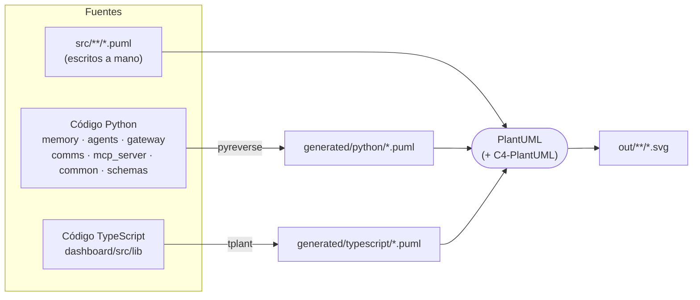
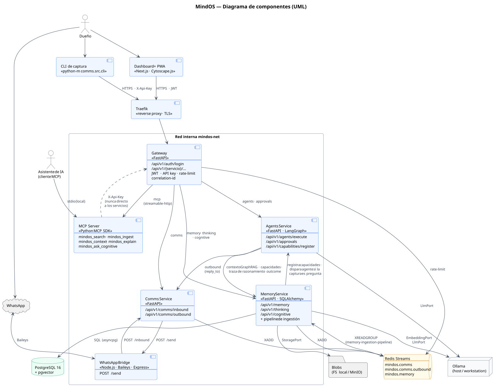
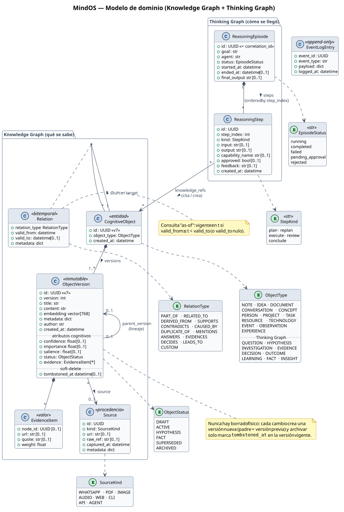
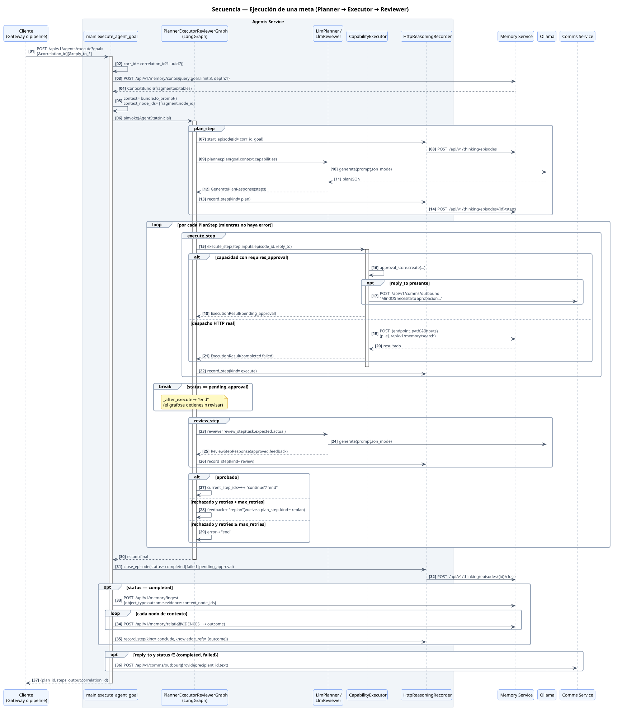

# MindOS — Diagramas UML

Diagramas UML de MindOS como código: fuentes `.puml` versionadas junto al código, diagramas de
clases extraídos automáticamente del código (ingeniería inversa) y un script que lo regenera todo
en SVG. Complementa el modelo C4 de [`docs/c4`](../c4) (LikeC4, niveles 1-2).



## Estructura

| Ruta | Contenido |
|---|---|
| [`src/estructura/`](src/estructura) | Diagramas estructurales: componentes, C4 nivel 3, despliegue, clases, ER. |
| [`src/comportamiento/`](src/comportamiento) | Casos de uso, máquinas de estados y actividades. |
| [`src/interaccion/`](src/interaccion) | Diagramas de secuencia de los flujos principales. |
| [`src/_tema.iuml`](src/_tema.iuml) | Estilo compartido (se incluye con `!include ../_tema.iuml`). |
| [`generated/`](generated) | `.puml` extraídos del código. **No editar a mano**: se sobrescriben al regenerar. |
| [`out/`](out) | SVG renderizados (se versionan para verlos directo en GitHub). |
| [`generate.py`](generate.py) | Script que instala las herramientas, hace la ingeniería inversa y renderiza. |

## Generar

Requisitos: **Python 3.10+**, **Java 11+** y, para el diagrama del Dashboard, **Node.js**.
Todo lo demás (PlantUML, pylint/pyreverse, tplant) lo descarga el script en `docs/uml/.tools/`
(ignorado por git); el jar de PlantUML está fijado a una versión y se verifica su SHA-256.

```bash
python docs/uml/generate.py                 # ingeniería inversa + render a SVG
python docs/uml/generate.py render          # solo renderizar (tras editar un .puml)
python docs/uml/generate.py reverse         # solo regenerar generated/ desde el código
python docs/uml/generate.py check           # validar la sintaxis de todos los diagramas
python docs/uml/generate.py render --format svg --format png
python docs/uml/generate.py --skip-typescript   # sin Node.js
```

- **Graphviz:** en Windows el jar de PlantUML trae `dot` embebido. En Linux/macOS se usa `dot` si
  está instalado (`apt install graphviz` / `brew install graphviz`); si no, el script cae al motor
  de layout interno de PlantUML (smetana), que no necesita nada extra.
- **Vista previa mientras editas:** extensión de VS Code
  [PlantUML (jebbs.plantuml)](https://github.com/qjebbs/vscode-plantuml) — `Alt+D` sobre un `.puml`.

### Añadir un diagrama

1. Crea `src/<categoría>/<nombre>.puml` empezando por `@startuml` + `!include ../_tema.iuml`
   (los diagramas C4-PlantUML usan `!include <C4/C4_Component>` y no llevan el tema).
2. `python docs/uml/generate.py render` → aparece `out/<categoría>/<nombre>.svg`.
3. Enlázalo en el índice de abajo.

## Herramientas elegidas

| Herramienta | Para qué se usa aquí |
|---|---|
| [PlantUML](https://github.com/plantuml/plantuml) | Motor de todos los diagramas UML (clases, componentes, despliegue, casos de uso, secuencia, estados, actividad, ER). |
| [C4-PlantUML](https://github.com/plantuml-stdlib/C4-PlantUML) | C4 nivel 3 (componentes del Memory Service). Viene en la stdlib del jar: sin red. |
| [Pyreverse](https://github.com/pylint-dev/pylint) (pylint) | Clases y paquetes de cada servicio Python, directo del código. |
| [tplant](https://github.com/bafolts/tplant) | Interfaces/clases TypeScript del Dashboard (tipos del API, cliente, auth, cola offline). |
| [Mermaid](https://github.com/mermaid-js/mermaid) | Diagramas embebidos en Markdown que GitHub renderiza nativo (el flujo de arriba). |
| [LikeC4](https://github.com/likec4/likec4) | Ya en uso en [`docs/c4`](../c4) para C4 niveles 1-2 publicados en GitHub Pages. |

Se descartaron para no duplicar motores: D2 y Structurizr (C4 ya está cubierto por LikeC4 +
C4-PlantUML), Kroki (útil como servidor de render en el homelab, pero el jar local basta),
DBML (el ER sale de PlantUML) y los modeladores GUI (drawio, Gaphor), que no son diffables.

## Índice de diagramas

### Estructura

| Diagrama | Qué muestra |
|---|---|
| [Componentes](out/estructura/componentes.svg) | Servicios, sus interfaces REST, el Event Bus y la infraestructura. |
| [C4 nivel 3 · Memory Service](out/estructura/c4-componentes-memory.svg) | Routers, servicios de aplicación y adaptadores dentro de Memory. |
| [Despliegue](out/estructura/despliegue.svg) | Contenedores de `infra/docker-compose.yml`, volúmenes, host y workstation. |
| [Modelo de dominio](out/estructura/clases-dominio.svg) | Objeto cognitivo versionado, procedencia, relaciones bitemporales y Thinking Graph. |
| [Memory · hexagonal](out/estructura/clases-memory-hexagonal.svg) | Puertos y sus adaptadores de producción y de pruebas. |
| [Agents](out/estructura/clases-agents.svg) | Planner/Executor/Reviewer sobre LangGraph, puertos y DTOs. |
| [ER de PostgreSQL](out/estructura/er-base-de-datos.svg) | Tablas, claves e índices de las migraciones Alembic 0001-0004. |





### Comportamiento

| Diagrama | Qué muestra |
|---|---|
| [Casos de uso · captura](out/comportamiento/casos-de-uso-captura.svg) | Canales de captura y lo que dispara cada captura. |
| [Casos de uso · consulta y razonamiento](out/comportamiento/casos-de-uso-consulta.svg) | Búsqueda, GraphRAG, 7 preguntas, /explain, metas y aprobaciones. |
| [Estados · episodio y aprobación](out/comportamiento/estados-episodio-y-aprobacion.svg) | Ciclo de vida de `ReasoningEpisode` y `ApprovalRequest`. |
| [Estados · objeto cognitivo](out/comportamiento/estados-objeto-cognitivo.svg) | Versionado, archivado/restauración (soft-delete) y `ObjectStatus`. |
| [Actividad · ingesta](out/comportamiento/actividad-ingesta.svg) | `POST /memory/ingest`: dedup, procedencia, eventos y contradicciones. |
| [Actividad · bucle del agente](out/comportamiento/actividad-agente-langgraph.svg) | plan → execute → review con reintentos, replan y pausa por aprobación. |

### Interacción

| Diagrama | Qué muestra |
|---|---|
| [Captura por WhatsApp](out/interaccion/secuencia-captura-whatsapp.svg) | Baileys → Comms → Redis → pipeline de Memory → ingesta, auto-enlazado y agente. |
| [Ejecución de una meta](out/interaccion/secuencia-ejecucion-agente.svg) | Contexto GraphRAG, LangGraph, traza en el Thinking Graph y nodo `outcome`. |
| [Resolución de aprobación](out/interaccion/secuencia-aprobacion.svg) | Bandeja del Dashboard → Gateway → Agents → capacidad diferida. |
| [Gateway: auth y proxy](out/interaccion/secuencia-gateway-auth.svg) | Login JWT, rate-limit, `X-Correlation-Id` y proxy a los servicios. |



### Generados desde el código

| Paquete | Clases | Paquetes |
|---|---|---|
| memory | [classes_memory](out/generated/python/classes_memory.svg) | [packages_memory](out/generated/python/packages_memory.svg) |
| agents | [classes_agents](out/generated/python/classes_agents.svg) | [packages_agents](out/generated/python/packages_agents.svg) |
| gateway | [classes_gateway](out/generated/python/classes_gateway.svg) | [packages_gateway](out/generated/python/packages_gateway.svg) |
| comms | [classes_comms](out/generated/python/classes_comms.svg) | [packages_comms](out/generated/python/packages_comms.svg) |
| mcp_server | [classes_mcp_server](out/generated/python/classes_mcp_server.svg) | [packages_mcp_server](out/generated/python/packages_mcp_server.svg) |
| common | [classes_common](out/generated/python/classes_common.svg) | [packages_common](out/generated/python/packages_common.svg) |
| schemas | [classes_schemas](out/generated/python/classes_schemas.svg) | [packages_schemas](out/generated/python/packages_schemas.svg) |
| dashboard (TS) | [dashboard](out/generated/typescript/dashboard.svg) | — |

## Fidelidad al código

Los diagramas de `src/` se escribieron leyendo el código actual (no solo el plan). Diferencias
con el modelo C4 de `docs/c4` encontradas al hacerlo:

- El **pipeline de ingestión** (OCR/STT, auto-enlazado, disparo del agente) vive en el **Memory
  Service** (`IngestionPipelineService`, consumidor de `mindos.comms`); Comms solo publica el
  `MessageReceivedEvent` y entrega mensajes salientes.
- **Agents no usa el Event Bus**: se comunica con Memory y Comms por HTTP.
- El enrutado de modelos pesados a la **workstation** (`OLLAMA_URL_WORKSTATION`) está previsto
  en `.env.example` pero aún no cableado; en el despliegue aparece como relación prevista.

Al cambiar la arquitectura, actualiza los `.puml` afectados en el mismo PR y regenera
(`generated/` se actualiza sola con `python docs/uml/generate.py`).
